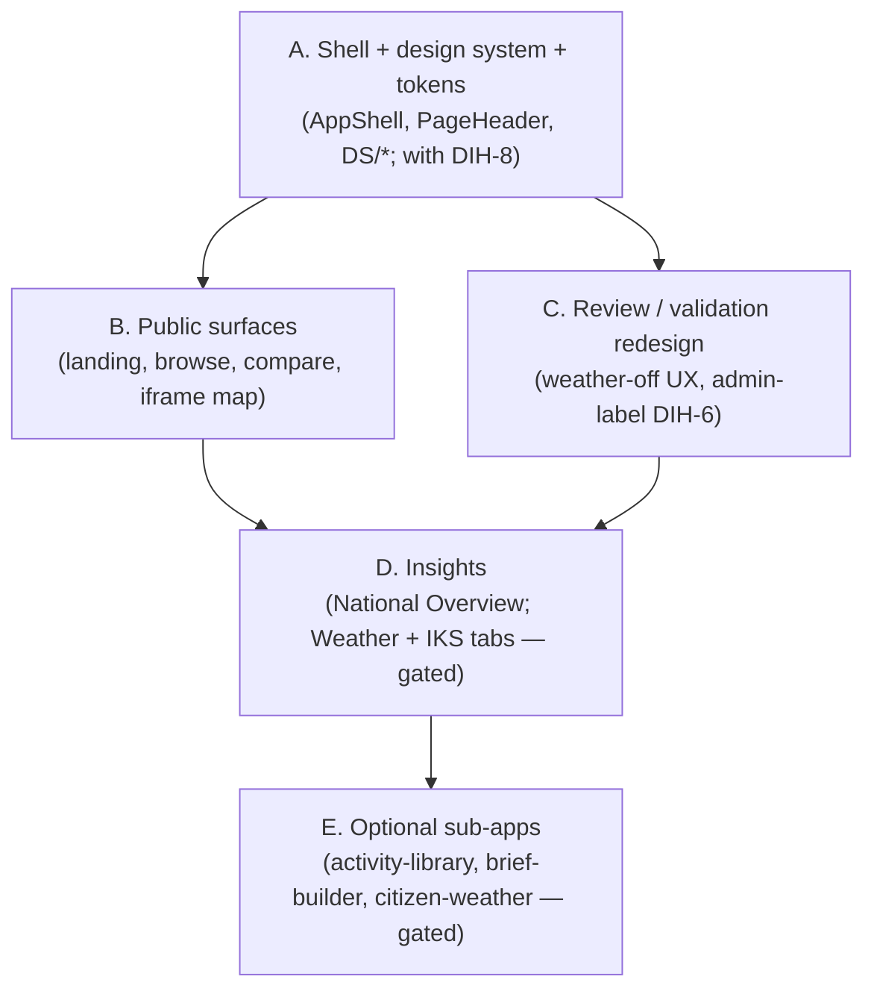

# Feature Design Document

## Feature: Port the Eswatini v2 UI surfaces into the generic hub (incremental)

**Task ID**: DIH-10 (sub-task of [MC-1](README.md); frontend / UI-UX transition)
**Author**: Iwan Firmawan (with Claude)
**Date**: 2026-10-29
**Status**: Draft
**Effort**: ~38h total (epic) → 5 phases ≤8h each (see §4): A ~8h, B ~6h, C ~8h, D ~8h, E ~8h.
**Depends on**: [DIH-8](DIH-8_theming-per-client-brand.md) (theming spine), [DIH-9](DIH-9_setup-wizard-theme-and-modules.md) (`modules` + `primary_color` in config), DIH-2 (module gating infra). Subsumes the frontend detail of DIH-3, DIH-5, DIH-6, and **folds in the weather-off reviewer contract directly** (the former standalone weather-off task; its backend half belongs to the `v1_weather` port).

---

> **Multi-tenancy (WS-3):** per-client config/branding is served **per host** via `tenant-info` ([MT-7](../3-multi-tenancy/MT-7_per-tenant-branding-config.md)), not a single per-deploy `appConfig` cookie. The porting work here (shell, DS, surfaces, theming sinks) is unchanged; only the **source** of colour/logo/admin-label/`features` becomes the host-keyed `tenant-info`. `useModule()` reads `tenant-info.features`. Standalone deploy = the `default` tenant.

## 1. Context & Problem Statement

```
The live v2 look (cdie.ndrma.org.sz, source eswatini-droughtmap-hub/frontend) is much
richer than the generic app/frontend:
  - a DS/ design system (MetricCard, SectorBadge, ConfidenceBadge, DroughtScore,
    ReviewerAvatar) + shell (AppShell, PageHeader, Navbar, Footer, TabButtons);
  - Insights (National Overview + Weather + IKS tabs), brief-builder, a redesigned
    review/validation workflow, activity-library, and a Citizen-Weather sub-app
    (its own cw-theme.js / --edm-* vars).
The generic hub has a simpler component set (basic Map/Forms/Modals, no DS/, no tokens).

It cannot be a wholesale copy: the generic hub must stay country-agnostic, the brand
colour is per-client (DIH-8), optional areas are module-gated (DIH-9), and the admin-unit
noun ("Inkhundla"/"Tinkhundla") + logos must come from config, not code.

Goal:
- Bring the v2 look into the generic hub surface-by-surface, behind module flags, so that
  Eswatini (all modules on, colour #3E5EB9) is identical to today, and a new country gets
  the same UX with its own colour, admin-label, logo, and only its enabled modules.
```

---

## 2. Scope

- Port the shared shell + design system + the per-surface UI, making each ported piece **theme-driven** (DIH-8), **module-gated** (DIH-9), and **label/logo-from-config**.
- Fold in: **the weather-off reviewer contract** (progress-only review map, no confidence toggle/bulk-accept, `meta.confidence_enabled=false`; the ported review surface must be weather-gated — generic repo has no confidence today, so it is introduced already gated), plus the frontend detail of DIH-3 (module flags → frontend), DIH-5 (map framing — already partly done via `CDIMap` `fitBounds`), DIH-6 (admin-unit label).
- **Not** a big-bang: ship surface by surface. Backend APIs those surfaces need are ported first (CDP-0 OQ-3 backend-first; e.g. `v1_geonode`, and later weather/IKS backends if those modules are adopted).

---

## 3. Cross-cutting config (applies to every ported surface)

| Concern | Source | Replaces |
|---|---|---|
| Brand colour | `appConfig.primary_color` → token/`--primary-color` (DIH-8) | 63 hard-coded `#3E5EB9` literals |
| Admin-unit label | `appConfig.country.admin_label.{one,many}` (e.g. Inkhundla/Tinkhundla, District/Districts) | hard-coded "Inkhundla"/"Tinkhundla" in `ValidationTable.js`, `static/config/*` |
| Module on/off | `appConfig.modules` (DIH-9) → `useModule("weather")` etc. | always-on assumptions |
| Logos | `appConfig.organizations[]` — the `is_host`-flagged entry's logo = brand/header logo (DIH-9) | static `public/images/logo-*` |
| Drought bands | `DROUGHT_CATEGORY_COLOR` (unchanged, not brand) | — |

When porting each Eswatini component, **sweep its brand-colour literals** → `var(--primary-color)` (CSS / ECharts-HTML tooltips) or the imported token (JS chart option objects), remove the rogue second `<ConfigProvider>` in `IksTab`, and drive `cw-theme.js` from the same resolved colour.

---

## 4. Order of work (incremental, module-gated)



| Step | Ports | Gated by | Notes |
|---|---|---|---|
| **A** | `tokens.js`, `ant-theme.js`, `DS/` primitives, `AppShell`/`PageHeader`/`Navbar`/`Footer`/`TabButtons` | — (core) | Lands with DIH-8. Establishes the look every later step reuses. |
| **B** | landing/`page.js`, `browse`, `compare`, `iframe/map` | — (core) | Public, country-agnostic. Map framing = DIH-5 (`fitBounds`, already partly done). |
| **C** | review + validation workflow redesign | core; weather-off branch (folded in from the ex-weather-off task) | Admin-label from config (DIH-6). With `weather` off → progress-only review map, no confidence/bulk-accept, `confidence_enabled=false`. |
| **D** | Insights: National Overview (core), Weather tab (`weather`), IKS tab (`iks`) | `weather`, `iks` | Tabs/panels appear only if the module is on; otherwise absent, not empty. |
| **E** | activity-library, brief-builder, citizen-weather | respective module flags | Citizen-Weather carries its own `cw-theme.js`; port only if `weather` is adopted. |

Each step's definition of done: components ported, brand-colour literals swapped to token/var, module-gated, admin-label + logos from config, and **Eswatini-all-on renders identically** to the live site.
**Per-phase effort (each ≤8h):** A ~8h · B ~6h · C ~8h · D ~8h · E ~8h. Each phase A–E is an independently shippable ≤8h slice; do them in order.


---

## 5. Decisions

- **D-1: incremental, not wholesale** (CDP-0 OQ-3). Each surface is a reviewable slice; the generic hub is always shippable.
- **D-2: every ported component is theme-driven and label/module-aware from day one** — no new hard-coded `#3E5EB9` or "Inkhundla" is introduced during the port (enforced by a CI grep, MC-1 §9 leak check).
- **D-3: Citizen-Weather is the last/optional slice** — it is a sub-app with its own theme and the largest surface; port only when a client adopts the `weather` module.
- **D-4: admin-unit label is config, not an identifier rename** — change only user-visible copy (UI, email, PDF), not variable/component names (MC-1 D-4), to keep the diff safe.
- **D-5: weather-off reviewer UX is folded in here** (ex-standalone task; MC-1 D-6). No stations → the ported review surface is progress-only, never an empty "check-back-later" confidence state. Backend half (emit `confidence=null` + `meta.confidence_enabled=false` when `weather` off) is owned by the `v1_weather` port; this task owns the frontend half (no toggle, default progress) in Phase C.

---

## Implementation steps

Ship surface-by-surface in the §4 order; each phase is an independently shippable ≤8h slice, "done" only when the §6 gates pass for it.

- **A — Shell + design system + tokens** (`tokens.js`, `ant-theme.js`, `DS/*`, `AppShell`/`PageHeader`/`Navbar`/`Footer`/`TabButtons`); lock the ECharts/Leaflet colour pattern (`var(--primary-color)` for CSS/HTML-string, imported token for JS options — OQ-2). → verify: DS component snapshots render in a themed colour; leak gate clean.
- **B — Public surfaces** (landing, browse, compare, iframe map). → verify: parity screenshot vs `cdie.ndrma.org.sz` for each; a non-Eswatini fixture recolours correctly.
- **C — Review / validation redesign** + the **weather-off contract** (ex-DIH-3: progress-only map, no toggle/bulk-accept, `confidence_enabled=false`) + admin-label from config (DIH-6). → verify: weather-off `CoreOnlyTestCase` assertions pass; configured admin label renders.
- **D — Insights** (National Overview core; Weather tab `weather`, IKS tab `iks`). → verify: a gated tab is absent when its module is off, present when on.
- **E — Optional sub-apps** (activity-library, brief-builder, citizen-weather). → verify: each present only with its module flag; citizen-weather driven by the same resolved colour.

Per-surface loop (goal-driven): write the snapshot/visual check first → port → pass gates 1–4 (§6) → next surface.

## User acceptance criteria

- As a **visitor**, each ported surface looks like the richer v2 site (cdie.ndrma.org.sz) but rendered in my country's colour, admin label, logo, and only my enabled modules.
- For **Eswatini** (all modules on, colour `#3E5EB9`), the site looks identical to today.

## 6. Technical acceptance criteria

- [ ] Each ported surface matches the v2 look, recolours to `appConfig.primary_color`, and uses the configured admin-unit label.
- [ ] A surface belonging to a disabled module is absent (route 404 / hidden menu), not an empty shell.
- [ ] **Weather off (Phase C):** the review surface renders progress-only — no Confidence/Progress toggle, no bulk-accept banner, no empty-confidence state — and the API carries `confidence: null` + `meta.confidence_enabled: false` (asserted in the `CoreOnlyTestCase`).
- [ ] Eswatini with all modules on and colour `#3E5EB9` is visually identical to the current `cdie.ndrma.org.sz`.
- [ ] CI leak check (MC-1 §9) passes: no `#3E5EB9` literal and no hard-coded "Eswatini/Inkhundla/Tinkhundla" in ported user-visible strings (allow-list: `tokens.js`, config, tests).
- [ ] A new country (fake fixture) with a different colour + admin-label + a subset of modules renders correctly end-to-end.

**Verify by (goal-driven; define the check before porting each surface, loop until green):**
1. **Per ported component** — write its snapshot/visual check first (themed colour + configured admin-label), then port until it passes.
2. **Parity gate** — Eswatini all-on + `#3E5EB9` produces a screenshot that matches the current `cdie.ndrma.org.sz` for each ported surface (Playwright screenshot diff, tolerance agreed).
3. **Genericity gate** — a fake non-Eswatini fixture (different colour + admin-label + a subset of modules): ported surfaces show the new colour/label, and every disabled-module route returns 404 / is absent from the menu.
4. **Leak gate (CI, MC-1 §9)** — `grep` finds no `#3E5EB9` literal and no hard-coded `Eswatini/Inkhundla/Tinkhundla` in ported user-visible strings (allow-list: `tokens.js`, config, tests).
A surface is "done" only when gates 1–4 pass for it.

---

## 7. Open questions

- [ ] **OQ-1**: How much of the Citizen-Weather sub-app to port, and does it stay a sub-app with its own theme or fold into the main shell? Defer until the `weather` module is actually adopted by a client. **— DEFERRED 2026-10-29: port only when `weather` is adopted; decide sub-app-vs-shell then.**
- [x] **OQ-2**: ECharts/Leaflet colour strategy — inject `var(--primary-color)` into HTML-string tooltips and read a runtime theme value for option objects; confirm one consistent pattern during Step A. **— RESOLVED 2026-10-29: `var(--primary-color)` for CSS/HTML-string (ECharts/Leaflet) + imported token for JS option objects; lock in Step A.**
- [x] **OQ-3**: Brand/header **logo** — add a dedicated `SiteConfig` logo field, or reuse an `organizations[]` entry flagged as the host? (DIH-9 follow-up.) **— RESOLVED 2026-10-29: reuse `organizations[]` + an `Organization.is_host` flag; the host entry's logo is the brand/header logo — no dedicated SiteConfig logo field.**
- [x] **OQ-4**: Which surfaces are truly "core" for a CDI-only deployment (no optional modules)? Proposed core: landing, browse, compare, publications, review, validation, National Overview. Everything else gated. **— RESOLVED 2026-10-29: adopted.**

---

## 8. References

- Eswatini UI: `eswatini-droughtmap-hub/frontend/src/components/{DS,Insights,Review,Validation,BriefBuilder,CitizenWeather,...}`, `src/static/{tokens.js,ant-theme.js,cw-theme.js}`
- Generic UI today: `app/frontend/src/components/*`, `src/app/*`, `src/context/AppContextProvider.js`
- Theming + config: [DIH-8](DIH-8_theming-per-client-brand.md), [DIH-9](DIH-9_setup-wizard-theme-and-modules.md); module model MC-1 §6
