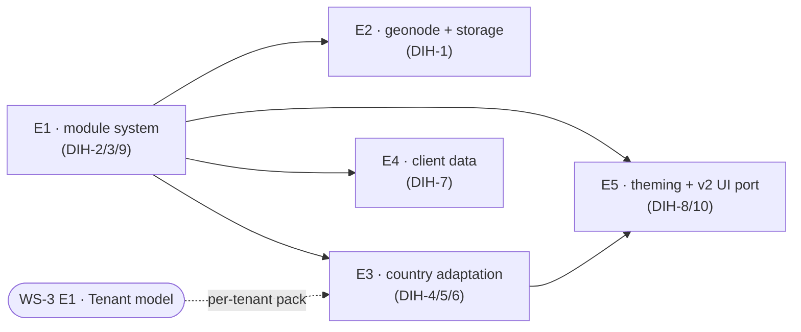

# Global DIH — 2. Port V2 improvements to the generic repo

> Bring the Eswatini hub's v2 app features into the generic multi-country hub as **optional, country-agnostic modules**.
> Backend APIs first, frontend iteratively (CDP-0 OQ-3).
> **Multi-tenancy (WS-3):** the target is now a multi-tenant hub; **D-1 is reframed** (standalone still possible via the `default` tenant). This changes DIH-1/2/4/9/10 — see [3-multi-tenancy](../3-multi-tenancy/README.md) §5 and the per-doc notes.

**Design overview**: this document is the WS-2 plan (it replaces the old `multi-country-deployment.md` / "MC-1" — that identity now lives here).
**Pipeline prerequisite**: [MC-2](../1-cdi-data-pipeline/cdi-inhouse-percentiles.md) — without it no country outside NDMC's `Southern_Africa` extent has a CDI to publish.
**Sibling workstream**: [1 — CDI data pipeline](../1-cdi-data-pipeline/README.md).
**Executed in**: **`akvo/drought-map-hub`** (`app/`). Not in the Eswatini repos; `eswatini-droughtmap-hub` stays its own deployment (D-1 / CDP-0 OQ-4).
**Status**: Planning. Not blocked by NDMC. DIH-1 is bootstrapped inside CDP-0; the rest are decomposed in their own `DIH-*` docs.

> **Path convention**: the DIH task docs carry **Eswatini-hub** code `file:line` refs — they locate the source logic to port; re-map them to `drought-map-hub/app` when executing each task.

---

## Summary

- **Today**: the generic hub has the CDI publish/review/validate core, but no optional-module system; several Eswatini assumptions are hard-coded (admin word, boundaries, zoom, module imports, brand colour).
- **Change**: make geonode / weather / IKS / risk-level / indicators / client-data **switchable** (`DIH_MODULES`), move country content to a per-deployment pack, make the brand colour per-client, and strip Eswatini hard-coding from the frontend.
- **Approach**: backend-first and incremental — not a big-bang app move. Eswatini (all modules on, colour `#3E5EB9`) must behave exactly as today.

**Principles (brainstorm 2026-09-30):** B-1 every country covered (CDI pipeline is the first blocker → MC-2); B-2 client data = one shape (admin × month × value); B-3 confidence **requires** weather stations; B-4 country config is team-owned via config, no admin UI; B-5 future-proofing, no second country committed yet; B-6 client data appears in Insights only, never feeds review/validation; B-7 IKS and risk level are switchable too.

---

## Sub-tasks (5 epics)

Grouped by natural deliverable. The per-task docs linked under each epic are its **phases/checklist**, not separate week-sized items; they keep their Implementation steps + User AC + Technical AC. Estimates are **port-of-working-code + agentic coding**, in days.

| # | Epic | Phases (detail docs) | Depends on | Estimate |
|---|---|---|---|---|
| **E1** | **Module system** — the flag mechanism end to end | [DIH-2](DIH-2_module-system.md) mechanism · [DIH-3](DIH-3_module-flags-frontend.md) frontend flags · [DIH-9](DIH-9_setup-wizard-theme-and-modules.md) wizard fields (`primary_color` + `modules`) | — | ~1.5d |
| **E2** | **Optional GeoNode + durable storage** | [DIH-1](DIH-1_v1-geonode-optional-app.md) (1a `v1_geonode`, 1b `STORAGE_PATH` + compose volume) — bootstrapped in [CDP-0](../1-cdi-data-pipeline/CDP-0_port-eswatini-pipeline.md) D-4 | E1 | ~1d |
| **E3** | **Country adaptation** — a new country served from a pack | [DIH-4](DIH-4_country-pack.md) pack + `country.json` · [DIH-5](DIH-5_map-framing.md) map framing · [DIH-6](DIH-6_admin-label.md) admin label (UI/email/PDF) | E1, MT-1 | ~2d |
| **E4** | **Client data** — generic per-admin datasets | [DIH-7](DIH-7_client-data.md) `v1_datasets` model + import + read-only API + "Other data" Insights tab | E1 | ~1.5d |
| **E5** | **Theming + v2 UI port** — the Eswatini v2 look, theme-driven & module-gated | [DIH-8](DIH-8_theming-per-client-brand.md) brand colour · [DIH-10](DIH-10_v2-ui-surface-port.md) design system + shell + pages (subsumes DIH-3/5/6 frontend detail + weather-off reviewer contract) | E1, E3 | ~3–4d |

**WS-2 total ≈ 2 weeks**, dominated by **E5** (the UI surface port is real work even with Claude; the rest is wiring over a working Eswatini reference).

> **Frontend / UI-UX transition (detailed sub-plans):** [DIH-8](DIH-8_theming-per-client-brand.md), [DIH-9](DIH-9_setup-wizard-theme-and-modules.md) and [DIH-10](DIH-10_v2-ui-surface-port.md) carry the detail for moving the Eswatini v2 look (cdie.ndrma.org.sz) into `app/frontend` — a per-client brand colour (keeping Eswatini `tokens.js` as the baseline) and wizard-driven module toggles (GeoNode / weather / IKS). DIH-10 subsumes the frontend detail of DIH-3, DIH-5 (map framing, already partly done) and DIH-6, and folds in the weather-off reviewer contract. The ready-to-build backend + theming slice (DIH-9 `SiteConfig` fields + DIH-8 colour MVP) is broken down file-by-file in each doc's **Implementation steps** section.

---

## Order of work

- **"Future-proofing now" slice (B-5):** DIH-1 (with CDP-0), DIH-2, DIH-3. Low-risk, no second country required.
- **Waits for a real second country:** DIH-4, DIH-5, DIH-6, DIH-7.
- **Not blocked by NDMC** — this workstream is independent of the CDI method questions.

---

## Module matrix (`DIH_MODULES`)

| Module flag | Django app(s) gated | Frontend surface gated | Scheduled jobs gated |
|---|---|---|---|
| *(core, always on)* | `v1_init`, `v1_jobs`, `v1_users`, `v1_publication`, `v1_activity`, `v1_rundeck`, `v1_insights` | review, validation, CDI insights, national overview, SOP library | — |
| `geonode` | `v1_geonode` (new, CDP-0 D-4) | — (backend only: CDI publication-push) | — (off → endpoints 404; pipeline push skips, env-gated on `DROUGHTMAP_HUB_URL`/`_API_KEY`) |
| `weather` | `v1_weather` | Weather tab, confidence map mode, bulk-accept, citizen-science, brief weather block | WIS2, CHIRPS, AgERA5, CS reminders |
| `iks` | `v1_iks` | IKS tab, `soil-trend` header call, brief IKS block | Kobo download |
| `indicators` | `v1_indicators` | exposure overview layers, dataset uploads | dataset upload jobs |
| `risk_level` (requires `indicators`) | `v1_risk_level` | Risk level tab, brief risk block | — |
| `datasets` | `v1_datasets` | generic "Other data" Insights tab | — |

`DIH_MODULES` is a comma-separated env var; unset = all on. Per-client the wizard (`SiteConfig.modules`, DIH-9) narrows within what the env allows: `effective = env_allows ∧ wizard_enabled`.

---

## Decisions already made

| Ref | Decision |
|---|---|
| D-1 | ~~One instance per country, not multi-tenant.~~ **Reframed by [WS-3](../3-multi-tenancy/README.md) (10-30):** multi-tenant hub is the target; standalone still possible as the `default` tenant. `COUNTRY_DIR` is **removed** — the country is chosen by `request.tenant`, not an env path (see DIH-4 note + MT-1/MT-6). |
| D-2 | A disabled module stays installed, just not wired (its FKs/tables survive; an empty table is inert). |
| D-3 | Core call sites guard (`module_enabled` + local import), they do not plug into a registry. |
| D-4 | Admin label lives in `country.json`, delivered via `config.js`; replace only user-visible strings, not identifiers. |
| D-5 | Client data is a long table (`admin × month × value`) in its own optional `v1_datasets` app; no `Publication` link. |
| D-6 | No weather stations → the reviewer map is progress-only, not an empty "check back later" state. |
| CDP-0 OQ-2/3 | `v1_geonode` is a new standalone **optional** app; port backend APIs first, frontend iteratively. |
| OQ-3 | Prefix GeoNode categories per country (shared GeoNode under the one-VM model). |

---

## Cross-cutting QA

- A `CoreOnlyTestCase` (`override_settings(DIH_MODULES=[])`) is the shared gate (owned by [DIH-2](DIH-2_module-system.md)): reviewer map `confidence: null` + `confidence_enabled: false`, validation rows build, brief builds without IKS/risk blocks, national overview loads, weather/IKS/risk URLs 404, `config.js` lists no modules.
- **CI leak check**: a grep that fails on `eswatini|Eswatini|Inkhundla|Tinkhundla` and the brand `#3E5EB9` in user-visible frontend strings / email / PDF templates (allow-list: `source/`, tests, comments). The generic hub regressed exactly here.

---

## Open questions

Deferred to execution (recommendations recorded):
- OQ-2: keep a CDI-only brief (do not make the brief itself optional).
- OQ-4: English UI acceptable initially; `admin_label` is the first localisation seam.

None blocks starting DIH-1 / DIH-2. Task-specific open questions live in each `DIH-*` doc.

---

## References

- Pipeline prerequisite: [MC-2](../1-cdi-data-pipeline/cdi-inhouse-percentiles.md)
- Hinge task: [CDP-0](../1-cdi-data-pipeline/CDP-0_port-eswatini-pipeline.md) (DIH-1 `v1_geonode`)
- Session handoff: [HANDOFF](../HANDOFF.md) §6 (two workstreams)
- Prior art: generic Drought-map Hub — `github.com/akvo/drought-map-hub` (`app/backend/api/v1/v1_setup/`, `app/backend/utils/geojson_processor.py`)
