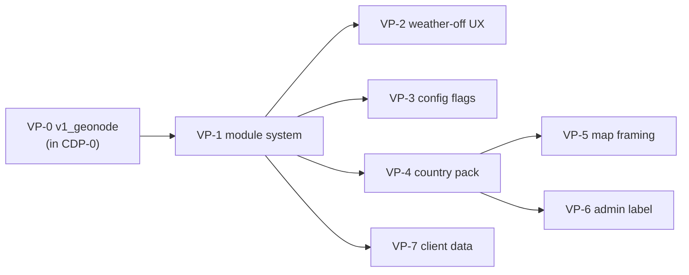

# Global DIH — 2. Port V2 improvements to the generic repo

> Bring the Eswatini hub's v2 app features into the generic multi-country hub as **optional, country-agnostic modules**.
> Backend APIs first, frontend iteratively (CDP-0 OQ-3). One instance per country (MC-1 D-1).

**Parent design**: [MC-1 — Multi-country deployment](multi-country-deployment.md)
**Sibling workstream**: [1 — CDI data pipeline](../1-cdi-data-pipeline/README.md) (MC-2)
**Executed in**: **`akvo/drought-map-hub`** (`app/`). Not in the Eswatini repos; `eswatini-droughtmap-hub` stays its own deployment (MC-1 D-1 / CDP-0 OQ-4).
**Status**: Planning. Not blocked by NDMC. VP-0 is bootstrapped inside CDP-0; the rest are decomposed further when scheduled.

> **Path convention**: MC-1 was written against the **Eswatini hub** code (`backend/api/v1/...` file:line refs). Those refs locate the source logic to port; re-map them to `drought-map-hub/app` when executing each VP.

---

## Summary

- **Today**: the generic hub has the CDI publish/review/validate core, but no optional-module system; several Eswatini assumptions are hard-coded (admin word, boundaries, zoom, module imports).
- **Change**: make weather / IKS / risk-level / indicators / geonode / client-data **switchable** (`DIH_MODULES`), move country content to a per-deployment pack, and strip Eswatini hard-coding from the frontend.
- **Approach**: backend-first and incremental — not a big-bang app move. Eswatini (all modules on) must behave exactly as today.

---

## Sub-tasks

| ID | Plan | What it delivers | Depends on | Size |
|---|---|---|---|---|
| **VP-0** | Optional `v1_geonode` app | Extract the geonode publication-push endpoints (`geonode/publications` + `/rasters`) from the Eswatini `v1_publication` into a new, standalone, **optional** app; gate with `DIH_MODULES`. **Bootstrapped in [CDP-0](../1-cdi-data-pipeline/CDP-0_port-eswatini-pipeline.md) D-4.** | — | M |
| VP-1 | Module system (`DIH_MODULES`) | `module_enabled()` + gated URLs and `job.sh`; guard the ~8 core call sites behind flags; fix the stale `v1_weather` comment (MC-1 §1) | — | M |
| VP-2 | Weather-off reviewer UX | Progress-only review map (no confidence toggle, no bulk-accept), `meta.confidence_enabled=false` | VP-1 | S |
| VP-3 | Module flags → frontend | `config.js` carries `modules`/`country`/`datasets`; Insights tabs, brief blocks and overview layers respect them | VP-1 | M |
| VP-4 | Country pack (`COUNTRY_DIR`) | Generic `source/` file names; `country.json` (zones, admin label, region colours, TWG, contacts); drop `AdministrationZones` choices; `import_admin_boundary` command | VP-1 | M |
| VP-5 | Map framing from bounds | `fitBounds` on the loaded topojson; remove `DEFAULT_CENTER` and the fixed zoom copies | VP-4 | S |
| VP-6 | Admin label from config | `useAdminLabel()` across user-visible UI, email and PDF copy | VP-4 | L (mechanical) |
| VP-7 | Client data (`v1_datasets`) | `AdminDatasetValue` model, `import_admin_dataset`, read-only API, generic "Other data" Insights tab | VP-1 | M |

---

## Order of work

- **"Future-proofing now" slice (MC-1 B-5):** VP-0 (with CDP-0), VP-1, VP-2, VP-3. Low-risk, no second country required.
- **Waits for a real second country:** VP-4, VP-5, VP-6, VP-7.
- **Not blocked by NDMC** — this workstream is independent of the CDI method questions.

---

## Decisions already made (from MC-1 / CDP-0)

| Ref | Decision |
|---|---|
| MC-1 D-1 | One instance per country, not multi-tenant. |
| MC-1 D-2 | A disabled module stays installed, just not wired. |
| MC-1 D-3 | Core call sites guard (`module_enabled`), they do not plug into a registry. |
| CDP-0 OQ-2/3 | `v1_geonode` is a new standalone **optional** app; port backend APIs first, frontend iteratively. |
| MC-1 OQ-3 | Prefix GeoNode categories per country (shared GeoNode under the one-VM model). |

---

## Open questions

Deferred to execution (recommendations recorded in MC-1 §10):
- MC-1 OQ-2: keep a CDI-only brief (do not make the brief itself optional).
- MC-1 OQ-4: English UI acceptable initially; `admin_label` is the first localisation seam.

None blocks starting VP-0 / VP-1.

---

## References

- Parent: [MC-1](multi-country-deployment.md) (§11 Work Breakdown maps to VP-1…VP-7)
- Hinge task: [CDP-0](../1-cdi-data-pipeline/CDP-0_port-eswatini-pipeline.md) (VP-0 `v1_geonode`)
- Session handoff: [HANDOFF](../HANDOFF.md) §6 (two workstreams)
