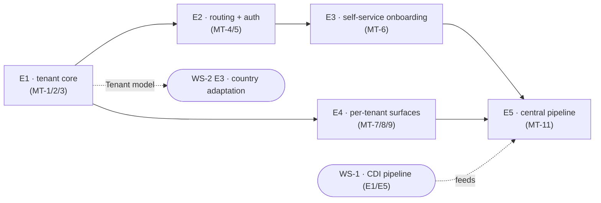

# Global DIH — 3. Multi-tenancy (foundation)

> **Status**: Foundation / proposal. This document defines the target architecture and the task series; it must be reviewed and agreed **before** the cascade edits to WS-2 (DIH-1..10), HANDOFF and README are applied.
> **Pattern source**: Akvo MIS `MT-*` design docs (`akvo-mis/doc/design`). We reuse its proven slices; we do **not** copy the parts MIS has and we don't (it has no heavy external pipeline).

---

## 1. Why, and what changes

Today the plan assumes **D-1: one instance per country** — one app, one Postgres, one CDI pipeline/VM, one country pack on disk. Multi-tenancy lets **one hub deployment serve many countries**, each at its own subdomain, with self-serve onboarding and shared ops — the model Akvo MIS already runs.

**This reframes D-1, it does not delete it.** A tenant can still be deployed standalone (a "default" tenant, base domain). Existing single-tenant deployments (Eswatini) keep working unchanged via a backfilled `default` tenant.

## 2. Target architecture — **hybrid** (agreed 2026-10-30)

| Layer | Decision | Rationale |
|---|---|---|
| **Hub web/DB** (review, validate, publish, browse, insights, users, config) | **Multi-tenant** — `Tenant` model + row scoping + subdomain routing (MIS playbook) | all of it is Postgres rows; MIS proves this is tractable |
| **GeoNode** (raster store) | **Shared, one instance** — per-tenant **category prefix** (OQ-3); `geonode_id` stays globally unique | GeoNode is not tenant-aware, but unique ids + category prefix give coexistence + attribution; CDI maps are public so a shared catalog is acceptable |
| **CDI pipeline** (`cdi/`) | **Central multi-tenant pipeline** (default): one Akvo pipeline that discovers active tenants from the hub, runs CDI per tenant (loop over each tenant's bounds/weights), and pushes results back — with an **external per-tenant pipeline** as an opt-in fallback | the pipeline is already single-country-per-run + subsets data per bbox, so multi-tenant = a loop; shared NASA/CDS creds (one Akvo account — public science data) remove the per-tenant credential problem, and auto-discovery makes onboarding fully self-service. Cost: compute/CDS-queue scale linearly (bounded parallelism + per-tenant failure isolation needed) and the central pipeline is a single point of failure |

**The bridge:** the **central pipeline** reads the list of active tenants + their config (bounds, weights, country) from the hub over an authenticated API, runs CDI for each, uploads to the shared GeoNode under that tenant's category prefix, and pushes to the hub via `v1_geonode` (DIH-1) with an **internal service identity + tenant id**. A tenant that instead runs its **own external pipeline** uses an **auto-generated per-tenant API key** (D-MT-3) to push. Either way the hub stamps each `Publication` with the right tenant. The hub never trusts a client-supplied tenant. Each tenant's CDI working data lives in its **own sub-directory under one volume** (`/app/data/<subdomain>/`), created at runtime — not a volume per tenant (§10).

```
  tenant-a.hub  ─┐                     ┌─ central CDI pipeline (loops all tenants) ─┐
  tenant-b.hub  ─┼─ one multi-tenant ──┤    reads tenant configs from hub API        ├─→ one shared GeoNode
  tenant-c.hub  ─┘   hub (row-scoped)  └─ (+ optional external pipeline per tenant) ──┘   (category per tenant)
       ▲ host = tenant                       │ push via v1_geonode
       └───────────────────────────────────┘  (service identity / per-tenant key)
```

## 3. Tenancy model (adapted from MIS MT-002/003/004/008/013)

- **`Tenant`** model in `v1_users`: `subdomain` (unique DNS label, also the identity), `is_active`, `deleted_at`, `features` (JSONField — replaces the per-instance `DIH_MODULES`), `language`, `logo`, plus the country config now on `SiteConfig`.
- **Direct tenant FK** on the definition roots: `SiteConfig` (one row **per tenant**), `Organization`, `Administration`, `Publication`, `SystemUser` — **plus `Jobs`** (verified: no `user`/owner FK exists in this repo, so it cannot derive). Everything else derives through joins:

  | Model | TENANT_PATH | Note |
  |---|---|---|
  | `SiteConfig`, `Organization`, `Administration`, `Publication`, `SystemUser` | `tenant` (direct) | |
  | `Jobs` | `tenant` (direct) | no `user` FK to derive from — verified |
  | `Review` | `publication__tenant` | |
  | `AdminDatasetValue` (DIH-7) | `administration__tenant` | model new in DIH-7 |
  | GeoNode link | `Publication.tenant` + category prefix | **no `PublicationGeonode` model in this repo** — link is `Publication.cdi_geonode_id` + the live `CDIGeonodeAPI` |

- `SystemUser` already carries an `organization` FK (`SET_NULL`); `Tenant` sits **above** `Organization` (one tenant → many orgs/TWG). The user keeps `organization` and **gains** `tenant`.
- **Read isolation**: explicit `for_user(user)` manager method (authenticated) and `for_tenant(request.tenant)` (public/unauthenticated: browse/compare/iframe) + per-model `TENANT_PATH` (MIS rejected middleware+thread-locals — greppable/testable wins). Every tenant-owned query routes through one of them.
- **Write enforcement**: serializer mixin **stamps** `tenant` from the authenticated user (client-supplied `tenant` never trusted); update/delete via `get_object_or_404(for_user(...))`; payload FKs validated per-tenant.
- **Routing**: `TenantMiddleware` resolves `request.tenant` from the **subdomain**; an authenticated session is bound to the host's tenant (403/redirect on mismatch). `GET /api/v1/tenant-info` (public, host-keyed) serves per-tenant branding/config — **replacing the single baked `appConfig`**.
- **Email per tenant**: `SystemUser.email` drops global `unique=True` → `UniqueConstraint(email, tenant)`; tenant-aware auth backend scopes login to `request.tenant`. (`cdi_geonode_id` stays globally unique — correct for a shared GeoNode.)
- **Backward compatibility**: a migration creates `Tenant(subdomain="default")` and stamps all existing rows + tenant-less users (`NULL = NULL` keeps legacy/tests green). The `default` tenant is served on the **base domain** (MT-4, configurable), so a standalone install keeps working. Eswatini needs no data change.

## 4. Task series (WS-3) — 5 epics

Grouped by deliverable; the per-task docs under each epic are its phases/checklist (each keeps Implementation steps + User AC + Technical AC). Estimates are **adaptation of the MIS MT-\* patterns + agentic coding**, in days — not greenfield.

| # | Epic | Phases (detail docs) | Mirrors MIS | Estimate |
|---|---|---|---|---|
| **E1** | Tenant core — model + read/write isolation | [MT-1](MT-1_tenant-model-scoping.md) model + `default` backfill · [MT-2](MT-2_read-isolation.md) read (`for_user`/`TENANT_PATH`) · [MT-3](MT-3_write-enforcement.md) write stamp + guard | MT-002/003/004 | ~2.5d |
| **E2** | Routing + auth | [MT-4](MT-4_subdomain-routing.md) `TenantMiddleware` + `tenant-info` · [MT-5](MT-5_email-per-tenant.md) email-per-tenant + tenant-aware backend | MT-008/013 | ~1.5d |
| **E3** | Self-service onboarding | [MT-6](MT-6_self-service-onboarding.md) two-phase sign-up → verify → configure (boundary + modules) + auto-issued pipeline API key | MT-001/006 | ~1.5d |
| **E4** | Per-tenant surfaces | [MT-7](MT-7_per-tenant-branding-config.md) branding via `tenant-info` · [MT-8](MT-8_geonode-tenant-attribution.md) GeoNode category prefix + push attribution · [MT-9](MT-9_jobs-datasets-scoping.md) jobs/datasets scoping | MT-025/026/009 | ~1.5d |
| **E5** | Central multi-tenant pipeline (WS-1 side) | [MT-11](MT-11_central-pipeline.md) hub tenant-config API + `job.sh` tenant loop with per-tenant isolation + bounded parallelism + auto-discovery | — (CDI-specific) | ~2.5d |

*Deferred (not in the 5):* [MT-10](MT-10_platform-workspace.md) platform workspace + tenant inspection/switching — ops nice-to-have, post-MVP.

**WS-3 total ≈ 2 weeks**, with risk concentrated in **E1** (invasive scoping refactor across every query site) and **E5** (new orchestration). The MIS MT-\* docs are the reference, so this is adaptation, not greenfield.

### Order of work



**E1 is the hinge for WS-2:** the `Tenant` model it lands unblocks the per-tenant country pack in WS-2 E3. **E5 lands last** — it needs the WS-1 pipeline (CDP-0/CDP-6) and the `v1_geonode` push (WS-2 E2) plus the hub tenant-config API from E1–E3.

## 5. Cascade impact on WS-2 (applied only after this doc is approved)

| Doc | Change |
|---|---|
| **HANDOFF / WS-2 README** | Reframe D-1 ("standalone *or* multi-tenant"); add WS-3; update the order-of-work |
| **DIH-1** (v1_geonode) | push gains tenant attribution via `Publication.tenant` (and the `PublicationGeonode` cache FK, if DIH-1 ports that model) (→ MT-8 extends it) |
| **DIH-2** (modules) | `DIH_MODULES` per-instance → `Tenant.features` per-tenant; `module_enabled()` reads `request.tenant.features` |
| **DIH-4** (country pack) | **Rewritten** — `COUNTRY_DIR` is **removed entirely** (no env path picks the country; the tenant does). Country content is per-tenant: `SiteConfig` row per tenant + the boundary/zones uploaded during onboarding and stored per tenant (`STORAGE_PATH/tenants/<subdomain>/`, resolved from `request.tenant`); frontend config host-keyed, not a single baked `config.min.js` |
| **DIH-9** (setup wizard) | Becomes per-tenant onboarding (→ MT-6) |
| **DIH-10** (UI port) | Branding via host-keyed `tenant-info` (→ MT-7), not per-deploy `appConfig` |
| **WS-1 (CDP)** | **Substantial** (MT-11): `job.sh` loops active tenants read from a hub tenant-config API, with per-tenant failure isolation + bounded parallelism + central creds; the push carries tenant attribution. CDP-0/CDP-6 reworked for the central-pipeline model (external per-tenant pipeline remains a fallback) |

## 6. Cross-cutting invariants (adapted from MIS)

1. Every tenant-owned read **and** write routes through `for_user(user)` (authenticated) or `for_tenant(request.tenant)` (public/unauthenticated) / `TENANT_PATH`; a model without `TENANT_PATH` is intentionally global.
2. Tenant is always derived from the authenticated user (or the pipeline API key); a client-supplied `tenant` is never trusted.
3. The URL host identifies the tenant; a session is bound to its host's tenant (defense-in-depth on top of `for_user`).
4. Email is unique **per tenant**, not globally.
5. Per-tenant config/branding lives on `Tenant`/`SiteConfig` and is served by the host-keyed `tenant-info`, never baked into the frontend.
6. GeoNode is shared: unique `geonode_id` + per-tenant category prefix; the hub attributes each resource to a tenant on push.
7. Suspension/deletion enforced in one place (the host resolver), so live sessions die on the next request.

## 7. Hardest parts & what stays out of scope

**In scope but hardest (MT-11 — the central pipeline).** Quantified feasibility (numbers, scaling ceiling, SPOF failure budget, verdict) is in [MT-11 §7](MT-11_central-pipeline.md#7-feasibility-assessment) — **verdict: viable at 1 → low-double-digit tenants**; rework only forced at a scale off the roadmap. In brief:
- **Compute & CDS-queue scaling**: monthly runs are incremental and cheap; the yearly baseline rebuild is the real spike (gated + stagger-able). The binding ceiling is CDS **per-account concurrency (~10–12, shared by one central account)** — cap the `cdsapi` pool ≤8; shard accounts only if N outgrows the window.
- **Per-tenant failure isolation**: one country's fetch failure must not abort the run; `job.sh`'s current `exit 1` becomes continue-on-error + per-tenant reporting.
- **Single point of failure**: one central pipeline feeds every country → per-tenant monitoring + retry are mandatory (a per-deployment pipeline was naturally isolated; the central one is not).

**Out of scope:**
- **GeoNode hard isolation** — the shared catalog is discoverable; acceptable only because CDI maps are public. Sensitive per-tenant data would force per-tenant GeoNode workspaces (not planned).
- **Platform workspace / tenant inspection** (MT-10) — deferred; nice-to-have for ops, not required for the MVP.
- **Per-tenant NASA/CDS credentials** — not needed: the central pipeline uses one Akvo account (public science data); the external-pipeline fallback brings its own creds.

## 8. Decisions (resolved 2026-10-30)

- **D-MT-1 — no `COUNTRY_DIR`**: the per-box `COUNTRY_DIR` env is **removed entirely**; under multi-tenancy the country is chosen by `request.tenant`, never by a filesystem path. Country content is per-tenant (`SiteConfig` row + a per-tenant pack under `STORAGE_PATH/tenants/<subdomain>/`, resolved from the tenant). DIH-4 is rewritten accordingly; the "pick one of `source/india|indonesia|kenya`" scenario no longer exists.
- **D-MT-2 — self-service first**: onboarding is **self-service** (two-phase, email-verified), not operator-provisioned. See §9. (An operator/platform console, MT-10, is still optional/later for support.)
- **D-MT-3 — API key auto-issued (for external pipelines)**: a random **pipeline API key is generated automatically when a tenant is created/activated** (`TenantApiKey` row, hashed, revocable; key → tenant), shown once at onboarding. It is needed only when a tenant runs its **own external** pipeline; the default **central** pipeline pushes with an internal service identity. The hub never trusts a client-supplied tenant — the key (or service identity + tenant id) identifies it.
- **D-MT-4 — central multi-tenant pipeline (default)**: one Akvo CDI pipeline serves all tenants — it discovers active tenants + their config from the hub and loops over them; a tenant may opt into running its own external pipeline instead. This makes onboarding fully self-service (a new tenant joins the next run, no ops step) and simplifies credentials (one central NASA/CDS account). Accepted cost: linear compute/CDS-queue scaling and a central single point of failure (§7). Supersedes the earlier "pipeline stays per-deployment" stance.
- **D-MT-6 — base domain mapping is configurable**: `resolve_tenant_from_host` maps the **base domain** to the **`default` tenant** for a **standalone** install (so it keeps working post-backfill), or to **`None`** (a registration/landing page) for a multi-tenant SaaS — a single setting picks which. Resolves the earlier contradiction (standalone `default` vs base→`None`). Subdomains always resolve to their own tenant.
- **D-MT-7 — tenant admin is a role, not Django `is_superuser`**: the workspace owner gets the top **tenant role** (existing roles/abilities system), **not** `is_superuser=True`. `is_superuser` bypasses Django/DRF permission checks entirely, so using it as "tenant admin" is unsafe; it is reserved (with `is_platform_admin`, MT-10) for the tenant-less platform operator. Any residual `is_superuser` read path is still tenant-scoped by `for_user` (MT-2).
- **D-MT-5 — pipeline concurrency lives in `job.sh`**: **Rundeck** keeps *triggering* the monthly run (as today); the per-tenant loop + **bounded parallelism are implemented in the bash pipeline** (`xargs -P K` / background + `wait`), with **K = the CDS per-account pool cap (≤8, [MT-11 §7.1](MT-11_central-pipeline.md#7-feasibility-assessment))**. Rejected alternatives: **Celery** (not in the repo), **DjangoQ** (the app-side `qcluster` worker — a different node, wrong tool for the CDI pipeline), and **Rundeck per-tenant fan-out** (more ops config for no MVP gain). Standalone deploy = the same loop over the one `default` tenant.

## 9. Self-service onboarding flow (MT-6 detail)

Adapted from MIS MT-006 two-phase registration, plus this app's country-specific configure step.

1. **Sign up** `POST /api/v1/register` {email, password, subdomain, country name}: atomically create `Tenant(subdomain, is_active=False)` + `SystemUser(is_active=False)` with the top **tenant role** (not `is_superuser` — D-MT-7); claim the subdomain; send an email-verification token. No enumeration on resend.
2. **Activate** `POST /api/v1/register/activate` {token}: `is_active=True`; return auth token + `configured:false`.
3. **Configure** (auth, active-unconfigured): the country-specific step where DIH-4/DIH-9/DIH-10 converge —
   - upload a **boundary GeoJSON** → converted to the tenant's `admin.topojson` + numbered `Administration` rows seeded (DIH-4 `import_admin_boundary`, now per-tenant);
   - set admin-unit label, zones/region colours, brand colour, and **module selection** (`Tenant.features`);
   - add TWG organisations + logos.
4. **Data starts automatically**: because the **central pipeline** (D-MT-4) discovers active, configured tenants from the hub, the new tenant is **picked up on the next scheduled run** — no ops step, no key to paste. Onboarding is fully self-service end to end. The UI sets the expectation: *"Your workspace is ready; the first drought maps appear after the next monthly run."*

**Self-service end to end** (central-pipeline default):

| Fully self-service | Only when a tenant opts into its own external pipeline |
|---|---|
| Account, subdomain, email verification, branding, boundary upload, admin levels/zones, module choice — **and** drought data (central pipeline auto-discovers the tenant) | Standing up its own VM/Rundeck + its own NASA/CDS creds, and pasting its auto-issued API key (D-MT-3) |

So the earlier "assisted pipeline" boundary is gone for the default path: the central pipeline closes it. The only assisted case is a tenant that *chooses* to run its own pipeline.

## 10. Production deployment assessment

| Concern | Approach |
|---|---|
| **Topology** | One multi-tenant hub (web + Postgres + worker + Rundeck) behind **Traefik** with a **wildcard host `*.hub.domain`**; **one** shared GeoNode (category per tenant); **one** central CDI node/worker-pool that Rundeck drives over all tenants (loop or fan-out). |
| **DNS / TLS** | Wildcard DNS `*.hub.domain` + a **wildcard certificate** (Traefik + ACME DNS-01 challenge). Same subdomain model as MIS MT-008. |
| **Scaling knobs** | The scaling risk is **CDI compute + CDS queue**, not the web tier — bound pipeline concurrency, size the CDI node, or fan out as a job queue. Hub web scales normally (stateless + Postgres); GeoNode scales as its own infra; Postgres is the shared store (index tenant FKs). |
| **Secrets** | One central NASA Earthdata / CDS / Akvo account (not per tenant); per-tenant API keys only for external pipelines; `SETUP_SECRET`/JWT as today. |
| **Storage** | **One volume, a sub-directory per tenant** (keyed by subdomain) — **not** a volume per tenant, because self-service tenants appear at runtime and `docker-compose.yml` is static. Disk grows ~linearly (N × raw + working + baseline + geotiffs); plan accordingly. Same pattern on both sides: hub `STORAGE_PATH/tenants/<subdomain>/` (DIH-1) and CDI `/app/data/<subdomain>/`. |

**CDI storage — before vs after (the per-tenant layout is directories inside one volume):**

```
# today (single-tenant): cdi/docker-compose.yml
volumes:
  - input_data:/app/input_data          # one country's data
  - output_data:/app/output_data
  - ./config/cdi_project_settings.json:/app/cdi_project_settings.conf   # one country's config

# central multi-tenant: one data root, per-tenant sub-dirs created at runtime
services:
  cdi:
    volumes:
      - cdi_data:/app/data              # prod: named volume
    environment:
      - DROUGHTMAP_HUB_URL=...           # tenant list + per-tenant config come from the hub API
      - DROUGHTMAP_HUB_API_KEY=...       # (the single-file config bind is gone)
volumes:
  cdi_data:

# dev (cdi/docker-compose.dev.yml): bind so it is visible on the host
#   - ./data:/app/data   →   cdi/data/<subdomain>/{input_data,working_data,output_data,baseline}
```

So "separate storage" means **separate folders under one mounted volume**, visible locally in dev as `cdi/data/<subdomain>/…`; it is the volume (not each tenant) that appears in `docker-compose.yml`. The pipeline creates `<subdomain>/` on the fly from the tenant list it pulls from the hub.
| **Resilience** | The central pipeline is a **single point of failure** for all countries → per-tenant run status, alerting, and retry are mandatory; a failed tenant is skipped, not fatal. |
| **Backward compatibility** | A standalone single-tenant deploy is just the `default` tenant on the base domain with the same pipeline code pointed at one tenant — no separate build. |

## 11. References

- Pattern source: `akvo-mis/doc/design/MT-001..MT-030`.
- This repo's single-tenant anchors: `v1_setup/models.py` (`SiteConfig`, `Organization`), `v1_publication/models.py` (`Administration`, `Publication`, `Review`), `v1_users/models.py` (`SystemUser.email unique=True`), `v1_jobs/models.py` (`Jobs`).
- Sibling workstreams: [1 — CDI pipeline](../1-cdi-data-pipeline/README.md), [2 — V2 porting](../2-v2-porting/README.md).
